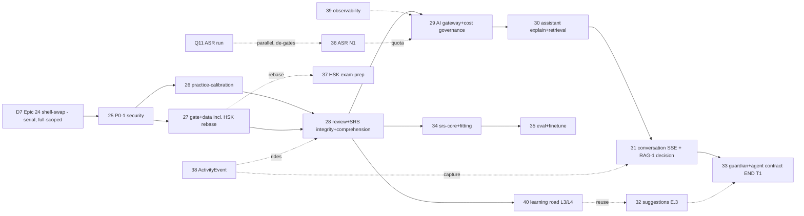

# Epic Plan 25–40 — Re-Sliced (Calibration + AI Roadmap)

**Status:** ✅ RATIFIED — owner-approved 2026-08-17; **D7 serial sequencing re-ratified 2026-08-21 (D10)** — full-scoped Epic 24 runs first to completion; epics 25–28 land on NestJS after

**Last Updated:** 2026-10-31 (Epic 26 close: as-shipped pointer added to §Epic 26, carrying the corrected A26 premise; Epic 25 close 2026-10-27: A25 supersession pointers added to §Epic 25; 2026 PO × Designer audit amendments — see §2026 Audit Amendments)

**Provenance:** Built from the Architect re-slice (epics 25–40, all blocks + sequencing + re-slice notes) + the OI-1…OI-10 decision record; anchored to the RATIFIED business model BM-1 + tech-mapping D1/D7 DECIDED. Promoted to `docs/planning/` as the committed source of record (2026-08-17); BRs for epics 25+ build against this plan. **2026-08-21 re-ratification:** the D7 execution model is **serial**, not parallel-with-25–28 (decision-log **D10**); this supersedes the earlier "D7 ∥ 25–28, P0-1 first gate" framing (see the Context Summary reversal note + OI-1).

> ⚠️ **Re-ratification (2026-08-21, D10):** the earlier **"D7 shell-swap parallel with 25–28; P0-1 first gate"** constraints are deliberately **reversed** — **full-scoped serial Epic 24 runs FIRST to completion (15 stories, including the P0-1 security stopgap as 24-1); epics 25–28 START AFTER, all on NestJS.** Every former B-gate becomes A (absorb) or C (declare). This is an owner decision (owner re-ratification), not an editorial change.

---

## Context Summary

Reviewed: `docs/business/business-model.md` (ratified L-series, P11-AMEND, Appendix B) plus the calibrated guest-access, tech-mapping, and production-readiness working specs. Locked constraints honored unchanged: D1=NestJS 11, **D7=full-scoped serial Epic 24 first; 25–28 after, on NestJS** (29/30/31 land on NestJS) — ⚠️ deliberate owner re-ratification 2026-08-21 (D10) **reversing** the earlier "D7=shell-swap parallel with 25–28" + "P0-1 first gate" framing; **P0-1 absorbed into Epic 24 (24-1 stopgap)** instead of being epic-25's gate 1; P0-2 re-based as data prerequisite, 4 satellite carve-outs, business-deferred items kept out of scope.

## Re-Slicing Principles

1. **Epic numbers 25–40 are kept stable** — every decision-log anchor (`epic-25` P0-1, `epic-27` rebase, `epic-29` quota, `epic-31` conversation demo-quota, `epic-36` Q11-gated, `epic-37` after rebase, `epic-38` ActivityEvent, `epic-39` observability, `epic-40` L3/L4) stays valid. No renumbering, no merges.
2. **Re-slicing is done by re-bounding** — sub-scope moved between epics so each has a single closable purpose with explicit non-goals.
3. **The four widest epics (26, 27, 29, 33) are structured as two gated milestones each** — each milestone is a closable horizontal/vertical slice with its own AC set, so no epic feels like a mega-epic. Each is flagged with a _recommended split_ if it grows.
4. **UI is folded into its epic** as `UI: <what> — design spec TBD`. Backend-only epics say `UI: none` explicitly.
5. **ACs are testable and gate-aligned** — backend → integration test / endpoint contract; frontend → component/story or e2e; close criteria reference the repo's two-tier gates (Tier 1 per-change, Tier 2 at story/epic-close).

---

## Design-System (Spine) Adoption Track

**Status:** ADDED 2026-10-24 — formalizes how the remaining spine adoption attaches to this plan. Spine
(`C:\CodeProjects\Personal\spine`) is the generic design-system source of truth; this repo owns only the
theme overlay and `domain.pinyinpal` support tokens.

**Current state (2026-10-21, commit `5b9f6012`):** foundation layer only — 5 `--page-measure-*` tokens plus
pad / rhythm / gutter, `PageShell` as the single archetype→measure map (16/18 routes conform),
`design-audit:foundation` gate, spine MCP wired. **Still open:** the Night Bench theme (ADR-011 ratified
2026-09-12, unapplied), semantic token-name alignment, the component model (closed variants + 12 states +
spec-first registry entries), full-scope gates in CI, and spine's review governance.

**Why this section exists:** 11 of the 16 epics below carry UI, all tagged "design spec TBD" and none
naming spine. The foundation-first principle still holds: a page conforms to the spine law BEFORE the epic
builds on it.

**Adoption mapping:**

| Adoption item                                                                                                                                                               | Owned by                                                             |
| --------------------------------------------------------------------------------------------------------------------------------------------------------------------------- | -------------------------------------------------------------------- |
| Token consolidation, semantic name alignment, Night Bench paint, **mode-aware chrome (rail collapse + recessed top bar + `mode`/`chrome` fields in `page-inventory.json`)** | **Pre-26 spine epic** (insert before Epic 26)                        |
| Gate/CI repair + doc/config alignment                                                                                                                                       | same pre-26 spine epic                                               |
| Component model (spec-first registry entries, per new surface)                                                                                                              | **each UI-carrying epic at BR time** (26, 28, 30–33, 36, 37, 39, 40) |
| Review governance (R0→R3 + rubric)                                                                                                                                          | process epic, reused at every UI epic close                          |

**Amends Re-Slicing Principle 4:** a UI-carrying epic's `UI:` line resolves at BR time against spine — it
names the page **archetype** (and its `--page-measure-*`), the **components** (existing spine registry or a
new spec-first entry), and the **states** (12-state set). "design spec TBD" means "design spec via spine
registry — see this track", not "to be invented per epic".

**Sequencing rule (spine `docs/design-process.md`):** semantic names before paint; paint before component
migration. Never restyle a surface before its tokens are aligned to spine's names.

---

## 2026 Audit Amendments (PO × Designer, 2026-10-26)

**Provenance:** the 2026 Product-Owner × Designer × market-data audit (working record: Resume repo
`context/topics/pinyinpal-vision/audit-2026/`). These amend the ratified plan above at the scope level.
They do **not** renumber epics (Re-Slicing Principle 1 holds); nothing is dropped. Each amendment is the
scope delta to apply at that epic's BR; where an amendment conflicts with the body above, the amendment
wins at BR time.

**A0 — Insert the pre-26 spine epic (mode-aware chrome).** The Design-System track names a "pre-26 spine
epic" for token consolidation + Night Bench paint; it must additionally own the **unimplemented half of
the design system: mode-aware chrome** — rail collapse + recessed top bar in Focus, plus `mode` and
`chrome` fields in `page-inventory.json` so the anatomy gate can enforce what it cannot currently even
represent. Without it, every Focus surface fails the dual-mode chrome law (NN1) and the two canonized
exemplars (`/practices/review`, `/practices/quiz`) ship one-mode. The chrome **build** is deferred to epic
execution; this section names the owner and scope. (Audit: Designer cross-epic summary; PO note 9.)

**A25 — Epic 25: re-bound the gate scope.** Remove the six phase-gated Learn routes from 25's boundary:
`business-model.md` §3 ratifies "Learn = no lock" for guests and L6 makes roadmap theory "signals, not
walls". Guest scarcity = session-local progress + demo quotas, not content walls. The guest-state region
also moves out of `AppLayout` (persistent) into a Browse-only surface. Keep P0-1, guest identity lockstep,
and guest cost-surface verification.

**A26 — Epic 26: precondition — quiz shell chrome first.** `/practices/quiz` fails the Focus chrome law
today (rail open, completion CTA outside a completion slot, `window.location.href` escape hatch). Fix the
shell before multiplying its surface by four formats; otherwise 26 propagates the defect.

**A27 — Epic 27-M2: HSK 3.0 confirmation + verify-at-BR.** The rebase is correctly pinned to the 2025
syllabus (3,088 chars / 10,943 words / 300–5,400 cumulative); the audit's market check confirms HSK 3.0
is 9 levels, released 2025-11, **worldwide launch 2026-12-13**, speaking compulsory from L3. Add to the
BR: re-verify the per-level counts against the official syllabus PDF (the audit could not load it), and
drop any residual "2026 revision" language — there is no further revision; "2026" refers to the 3.0
rollout date.

**A28 — Epic 28: two preconditions.** (1) Split the session picker out of `ReviewView` before the
comprehension surface lands — Review is the canonized North Star and must not host its own picker inside
the Focus column. (2) Scope interleaving to **confusable-similar categories only**: the interleaving
meta-analysis cautions against it for words generally; only discrimination learning benefits.

**A29 — no amendment.** The gateway/cost-governance epic is sound and is a hard dependency of 31/36.

**A30 — Epic 30: Explain slot must be mode-aware.** Keep the deterministic retrieval module (reused by
31/33). The Explain slot is an in-card Focus surface; it must collapse into the Focus chrome, not render
as an always-on card, and definitions are L2-only (matches the 2026 learning-science evidence).

**A31 — Epic 31: gate the spec on the #11 decision.** Before the conversation panel is specced, record
the composition/portals decision (extract `useFocusTrap` vs adopt Radix at 31). The panel is the first
compositional Focus surface and cannot be specced against a pattern that does not exist.

**A32 — Epic 32: split hosts by mode.** Recommendation cards are Browse (dashboard) only; the in-review
host is removed (it violates the one-task/one-CTA Focus law). Keep dismiss + why.

**A33 — Epic 33: defer M2, constrain M1.** Keep the E.4 content lane; the Made-for-You lesson is a
`detail` archetype with a single primary CTA (not a multi-CTA dashboard). **Defer M2 (G6 machine-token /
agent contract)** — lowest business value in the Tier-1 critical path; re-sequence it after Q11/37.

**A34 — no amendment.** Build on FSRS-6 (21 params, trainable decay) as planned.

**A35 — Epic 35: defer.** ML-ops eval/fine-tuning is `UI: none` and invisible to the demo funnel; defer
until the north-star metric exists and 34/40 have produced something to fit against.

**A36 — Epic 36: defer on Q11 (tightened to tone) + pitch-contour-first.** Q11 must validate **tone
grading**, not generic ASR (see the OI-7 caveat below). On pickup, the speaking UI must be
**pitch-contour-first** (visual F0 overlay — the only feedback with direct tone-efficacy evidence), and it
must consume the pre-written #10 dense-data spec rather than inventing it. Until Q11 passes, the §2
premium-AI pair ships conversation-only.

**A37 — Epic 37: name the archetypes + #10 dense spec ahead.** The exam-prep mode is `list` (part
picker) / `detail` (timed mock) / `reports` (results); `reports` is currently an unused closed-set
archetype. Write the #10 data-density spec before the timed-mock surface so the dense scan pattern is
designed once, not invented per page.

**A38/A39 — add the v0 north-star metric.** Define the metric in 38/39: **week-1 (D7) registered
retention** — % of new registered users active in their second week, computable from `account_registered`

- `ActivityEvent` (no guest telemetry required). The growth metric (demo→register) is added when guest
  telemetry unblocks. This closes the "no north-star" gap; 34/35/40 sequence against it.

**A40 — Epic 40: replace, not add.** "Next for you" **replaces** the phase gate as the default sequencing
rail; it does not sit beside it. Sequence 40 after the v0 north-star exists so its value is judgeable.

**A41 — Epic 41: re-derive against BM-1.** The traditional-character toggle was written before L1/L2; its
"gated to Phase 4+" and backend-persisted preference must be re-derived against the current model (demo
quota; no hard walls; persistence = the only lock), and the control moves out of the global nav into a
`settings`-archetype surface.

**Held out of this doc (BM-1's own gate):** the §2 positioning reframe (premium surface = "conversation +
per-syllable tone measurement") and the free-tier-vs-paywall pricing question are business-model changes;
they go through BM-1's change gate, not this plan.

**Execution is epic-distributed (2026-10-26).** The surface-level rework is NOT a separate shared-shell
program: it rides each UI-carrying epic at design-spec time. Every UI epic runs its surfaces through
revalidation and **reworks a surface
from scratch when revalidation fails** — the shared mode-aware chrome shell (rail collapse + recessed top
bar, PR #56) is the baseline each epic consumes, and the pre-26 spine epic (A0) finishes it. The
"session = route, not modal" rule (no third mode) is part of that guide and binds every session surface.

---

## Epic files

One file per epic. The amendments and sequencing below still govern them all.

| Epic | File |
| --- | --- |
| Epic 25 — Secure Guest Identity & Route Gating _(Phase A)_ | [Epic 25 — Secure Guest Identity & Route Gating](epics/epic-25.md) |
| Epic 26 — Practice Calibration: Engine Fixes + Guest Lane + Phase-B Fo | [Epic 26 — Practice Calibration: Engine Fixes + Guest Lane + Phase-B Formats](epics/epic-26.md) |
| Epic 27 — Gate & Data Calibration incl. HSK 2025-Rebase _(Phase C)_ | [Epic 27 — Gate & Data Calibration incl. HSK 2025-Rebase](epics/epic-27.md) |
| Epic 28 — Review & SRS Integrity + Comprehension _(Phase B, part 2 + P | [Epic 28 — Review & SRS Integrity + Comprehension](epics/epic-28.md) |
| Epic 29 — AI Gateway, Observability & Cost Governance _(E.0)_ _(Tier 1 | [Epic 29 — AI Gateway, Observability & Cost Governance](epics/epic-29.md) |
| Epic 30 — Assistant Explain + Deterministic Retrieval Seam _(E.1)_ _(T | [Epic 30 — Assistant Explain + Deterministic Retrieval Seam](epics/epic-30.md) |
| Epic 31 — Assistant Conversation (Text SSE) _(E.2)_ _(Tier 1)_ | [Epic 31 — Assistant Conversation (Text SSE)](epics/epic-31.md) |
| Epic 32 — Suggestions Recommender v0 _(E.3)_ _(Tier 1)_ | [Epic 32 — Suggestions Recommender v0](epics/epic-32.md) |
| Epic 33 — Guardian Content + Agent Contract _(E.4 + E.5)_ _(Tier 1)_ | [Epic 33 — Guardian Content + Agent Contract](epics/epic-33.md) |
| Epic 34 — FSRS Deep Modeling: `srs-core` + Fitting _(T2.1 + T2.2)_ _(T | [Epic 34 — FSRS Deep Modeling: `srs-core` + Fitting](epics/epic-34.md) |
| Epic 35 — Eval Harness & Fine-Tuning _(T2.5 + T2.6)_ _(Tier 2)_ | [Epic 35 — Eval Harness & Fine-Tuning](epics/epic-35.md) |
| Epic 36 — ASR Pronunciation & Tone Feedback _(N1)_ _(product-gated)_ | [Epic 36 — ASR Pronunciation & Tone Feedback](epics/epic-36.md) |
| Epic 37 — HSK Exam-Prep Mode _(N3)_ _(product lane)_ | [Epic 37 — HSK Exam-Prep Mode](epics/epic-37.md) |
| Epic 38 — ActivityEvent Substrate _(Phase D substrate)_ | [Epic 38 — ActivityEvent Substrate](epics/epic-38.md) |
| Epic 39 — Observability & Production Hardening | [Epic 39 — Observability & Production Hardening](epics/epic-39.md) |
| Epic 40 — Data-Driven Learning Road: `LearnerProfile` + "Next for You" | [Epic 40 — Data-Driven Learning Road: `LearnerProfile` + "Next for You"](epics/epic-40.md) |
| Re-slice Notes (vs §5) | [Re-slice Notes vs the earlier slice](re-slice-notes.md) |
| Resolved Open Items — OI-1…OI-10 (Decision Record) | [Resolved Open Items OI-1 to OI-10](open-items-oi-1-10.md) |

## Sequencing Summary

| Epic                                                        | Parallel with              | Needs first                           | Blocking gate / unblocks                                                                                                                                     |
| ----------------------------------------------------------- | -------------------------- | ------------------------------------- | ------------------------------------------------------------------------------------------------------------------------------------------------------------ |
| **25**                                                      | —                          | —                                     | P0-1 + guest-auth absorbed into Epic 24 (24-1/24-7/24-11); residual = FE route gating + guest-shell UI                                                       |
| **26**                                                      | —                          | 25                                    | FE quiz-engine fixes stay here (C-declared by 24-13); unblocks 28 (quiz-failure source), 32 (signals)                                                        |
| **27**                                                      | —                          | 25                                    | Stable content/phase metadata (C) + **HSK rebase**; radicals/foundations port already landed on current content (24-9); unblocks 28-M2, **37 (M2)**, 40 (M1) |
| **28**                                                      | —                          | 26, 27, P0-2                          | Closes **A–D data-integrity (P0-2)**; `SrsCardState` additive schema/vector absorbed into 24-11; unblocks 29 (SRS-touching AI), 33/40, 34                    |
| **29**                                                      | 26/27/38 (overlaps)        | 25, 28, 39 (P1/P2/P7)                 | Closes **S11 / P11-AMEND cost-governance gate**; unblocks 30/31/32/33/36                                                                                     |
| **30**                                                      | 31 (after)                 | 29, 26, 27, 28                        | E.1 + retrieval seam (**C14**); unblocks 31 (Retriever reuse)                                                                                                |
| **31**                                                      | —                          | 30, 29, 38                            | E.2 + **RAG-1/FV14 decision point** (must record before close)                                                                                               |
| **32**                                                      | 30/31                      | 26, 28, 29                            | E.3 (FSRS-free); unblocks 33-M1, 40 (infra reuse)                                                                                                            |
| **33**                                                      | —                          | 28, 29, 30, 32                        | E.4/E.5 — **END of Tier-1 critical path**                                                                                                                    |
| **34**                                                      | 35 (after)                 | 28, 38                                | **T2.1 FSRS before FSRS-weighted AI**; unblocks FSRS-weighted sequencing in 40                                                                               |
| **35**                                                      | —                          | 29/30–33, 38                          | T2.5/T2.6 (satellite `evals-pinyinpal`)                                                                                                                      |
| **36**                                                      | Q11 pass (parallel)        | 29, Q11, 39 (soft)                    | **N1 product-gate (Q11)** — Q11 run de-gates                                                                                                                 |
| **37**                                                      | —                          | 27-M2 only                            | N3 (HSK levels, by-exam-part)                                                                                                                                |
| **38**                                                      | 26/27 (rides 28 migration) | 25; coord. 28                         | Substrate; unblocks 29/31/34/35                                                                                                                              |
| **39**                                                      | 25–29 (parallel)           | —                                     | Observability; **P1/P2 must precede 29's close**                                                                                                             |
| **40**                                                      | —                          | 28, 38, 27, 32 (34 for FSRS-weighted) | L3/L4 learning road                                                                                                                                          |
| **D7 shell-swap** _(re-scoped epic-24, full-scoped serial)_ | — (serial-first)           | —                                     | **✅ COMPLETED 2026-08-22 (epic-24 close)** — ran to completion before 25; 25–28 land on NestJS after; 29/30/31 land on NestJS                               |

> **Serial note (2026-08-21, D10):** epics 25–28 no longer run parallel to D7 — they queue **behind full-scoped Epic 24**. Once started, 26/27/28 may still run parallel to each other (and to 38/39) per their dependency rows.

**Critical path (AI Tier-1):** **Epic 24 (D7, serial) first** → 25 → (26 ∥ 27) → 28 → 29 → 30 → 31 → 33, with **38 riding 28**, **39 parallel (P1/P2 before 29)** and **25–28 queued behind Epic 24**. **SRS deep path:** 25 → 26 → 28 → 34 → 35. Product lanes 36/37 and the learning road 40 attach at their single dependency (29+Q11 / 27-M2 / 28+38+32).

---

## What Still Genuinely Needs the Owner at BR Time (near-empty shortlist)

1. **epic-39 approval (Q1)** — the observability epic's **existence** is still a PROPOSAL pending owner sign-off (OB1–OB5 series). All content decisions (OI-8, OI-10) assume it exists; one tick confirms it.
2. **OB-series ratification (OB1–OB6)** — formally still PROPOSED; a single "confirm OB1–OB6" resolves the last formal-open series (they are baked into OI-4/OI-5/OI-6/OI-10 already).
3. **Q11 pass record review** — not a now-decision; the parallel run produces the record, and epic-36's BR gates on the owner's acceptance of it (OI-7).

Everything else in OI-1…OI-10 is now decided. The plan can be promoted with the Docs Writer folding this record into "Resolved Open Items" — no further back-and-forth beyond the three ticks above.

**Residual note (non-blocking):** the "studied-item" definition (Q3/G3) does not appear in the 10-item list; it was flagged as a pre-epic-30 need in feature-validation — confirm the re-sliced plan has resolved it before epic-30's BR locks, or carry it as a one-line BR-time item in epic-30 only.
